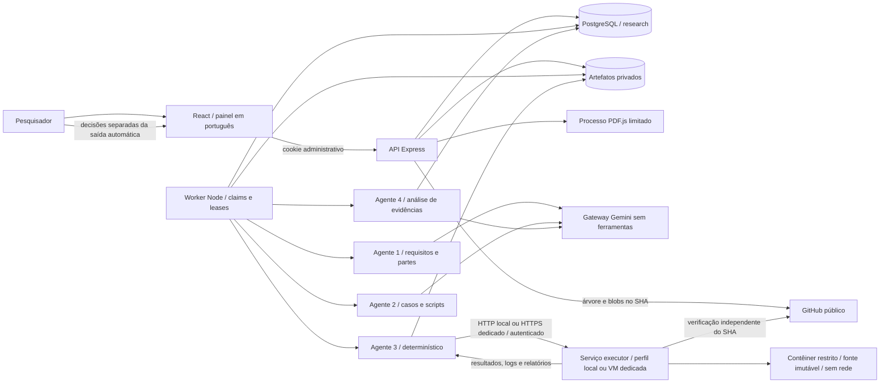
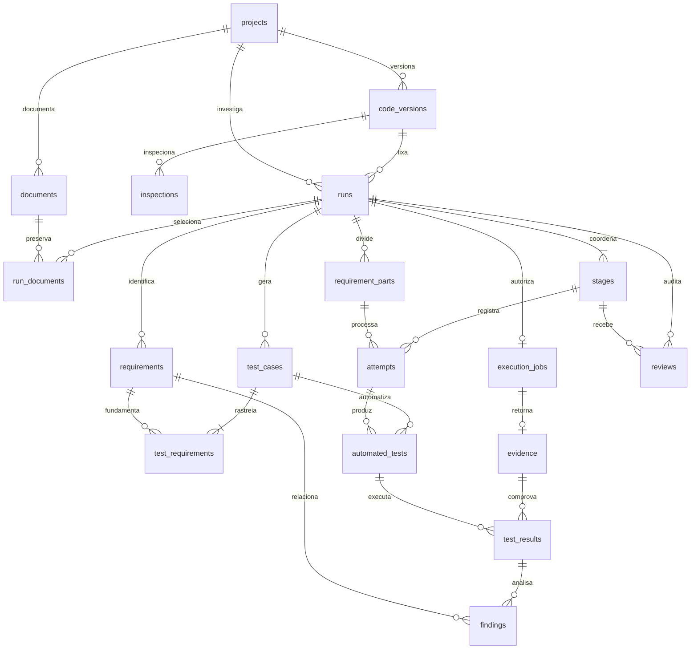
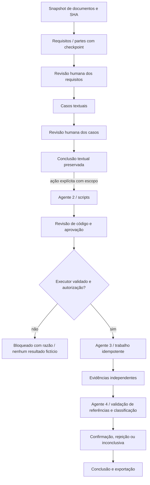

# Arquitetura da plataforma multiagente

Estado implementado em 30/10/2026. A aplicação preserva React/Vite/Tailwind, Express, PostgreSQL e Gemini. API, worker de agentes e serviço executor têm responsabilidades separadas. As rotas atuais estão em `backend/src/research/routes.js`.

**Situação operacional:** análise, geração, execução Node e avaliação possuem perfil local explícito `docker-desktop-dev`, iniciado por `npm run dev:local`, além do perfil padrão `dedicated-vm`. A imagem Node passou em 14 controles e dez cenários sintéticos reais. O modo local registra Docker Desktop compartilhado/cgroupfs, sem alegar VM dedicada/rootless; produção o recusa. Java e implantação dedicada permanecem pendentes. Fixtures continuam separadas de resultados de repositórios públicos. [Operação local](DESENVOLVIMENTO_LOCAL.md).

## Componentes

O backend não importa o runtime Docker nem cria processos de projetos. O worker recebe tarefas no PostgreSQL e usa exclusivamente o cliente HTTP(S) do executor. O serviço não tem `pg`, chave Gemini ou credenciais da aplicação. O token de transporte não entra no contêiner, nos prompts, bundles ou exportações. O launcher local passa ao serviço somente seu token/política e variáveis de sistema necessárias ao Docker; os `.env` do backend não são carregados nele.

Acorn foi acrescentado para análise estática de JavaScript; não carrega o código inspecionado. PDF.js extrai a camada textual em processo com prazo/heap limitados. Playwright é dependência de desenvolvimento para os fluxos de interface. Não há broker ou framework externo de agentes.

## Quatro agentes e subetapas

| Responsabilidade | Entrada | Saída / validação | Revisão |
| --- | --- | --- | --- |
| Agente 1 | Documentos/texto versionados, por inteiro ou em partes limitadas | Requisitos, condições, fluxos, incertezas, alertas; códigos únicos e citações existentes na página | Corrigir/aprovar/rejeitar cada requisito, depois aprovar etapa |
| Agente 2 / textual | Requisitos aprovados | Casos com passos, dados, esperado, cenário e vínculos válidos | Corrigir/aprovar/rejeitar cada caso |
| Agente 2 / `automation` | Casos aprovados e escopo técnico inspecionado no mesmo SHA | Um script por caso ou justificativa de impossibilidade; API/símbolos/imports, caminhos, SHA e esperado validados | Código editável com versão/antes/depois; aprovação separada da autorização de execução |
| Agente 3 | Bundle de fontes/scripts aprovados e recibo autorizado do executor | Execução determinística; estado, comandos, ambiente, resultados, logs e relatórios | Autorização humana anterior ao envio; sem inferência de defeito |
| Agente 4 | Requisitos/trechos originais, casos/scripts aprovados, observações e ambiente do executor | Classificação vinculada a resultado/requisito, esperado/observado preservados e citação literal da observação | Confirmar/rejeitar/inconclusiva, com justificativa e classificação humana separada |

`automation` é uma subetapa interna do agente 2, persistida na posição 5 para compatibilidade com as quatro posições anteriores. A interface mantém quatro cartões lógicos e apresenta scripts numa aba própria. Concluir o fluxo textual não afirma que testes foram executados; estendê-lo para automação exige nova ação justificada na mesma execução.

Instruções, versões e contratos estão em `agents.js`, `automation-contract.js` e `evaluation-contract.js`. As versões usadas ficam registradas no snapshot/etapa/entrada de cada tentativa. O Gemini recebe dados não confiáveis separados da instrução de sistema e não dispõe de ferramentas. A resposta precisa passar pela validação local, além do schema estrutural reduzido enviado ao provedor. Prompt injection não concede permissões de execução ou administração.

## Modelo de dados efetivo

Todas as entidades abaixo ficam no schema `research`. As migrações 009–014 são aditivas/transacionais, sob advisory lock e checksum normalizado CRLF/LF. Migrações aplicadas não são renomeadas nem alteradas. Tabelas antigas não são excluídas por essas migrações; scripts/documentos exclusivos do antigo experimento foram removidos do checkout e continuam no histórico Git.

Chaves compostas garantem vínculos de execução/projeto para versões, documentos, scripts, resultados e análises. Requisitos/casos guardam conteúdo estruturado e estado de revisão. Scripts guardam metadados e referência aos arquivos privados, tentativa geradora, versão/revisão e compatibilidade com o contrato. Essa compatibilidade estática **não comprova compilação, execução ou correção semântica**.

`execution_jobs` fixa bundle/hash e recibo de política/imagem; um trabalho por execução, com repetição idempotente do transporte. `evidence.origin` aceita somente executor. Não existe endpoint para importar um JSON arbitrário como execução real. Resultados individuais ficam vinculados a script, caso e evidência. `findings.content` preserva a proposta do agente; `review_status` e `human_classification` não a sobrescrevem. Revisões registram antes/depois, data, justificativa e ator administrativo.

PDFs, extrações, fontes, código gerado, snapshots, respostas e relatórios ficam em arquivos privados com UUID, tamanho e SHA-256. PostgreSQL armazena metadados/referências. Exportações resolvem arquivos e versões humanas dos scripts para permitir auditoria sem depender somente de chaves locais.

## Entrada e inspeção do código

Projetos aceitam somente URL HTTPS pública em `github.com/owner/repo`. API resolve branch/tag/ref para SHA de 40 caracteres por `api.github.com`, sem credenciais, redirects, clone ou execução. Salvar alterações cria outra versão de código. Cada execução fixa uma dessas versões, os documentos e o texto complementar.

A inspeção lê árvore no SHA e blobs regulares, verificando hash Git e SHA-256. Limites padrão: 5000 entradas de árvore, profundidade 8, 24 arquivos, 30 mil bytes por arquivo e 240 mil bytes no total. Após 30 s não inicia novas leituras; uma requisição já iniciada tem timeout de 12 s. Árvore truncada, arquivos grandes, caminhos não suportados e omissões são apresentados ao pesquisador.

São identificados manifestos e módulos internos, fontes, testes existentes, imports, exports JS e candidatos Java. Manifestos mais próximos delimitam módulos; manifestos ancestrais são preservados para manter semântica CJS/ESM. Símbolos Java usam inspeção lexical conservadora, sem carregar classes. Swing, SQL e dependências externas são sinais de restrição, não autorização para iniciar serviços.

O pesquisador escolhe até oito alvos e vinte casos aprovados. O fechamento inclui até doze fontes locais, dezesseis fontes/manifestos e sessenta mil caracteres de contexto técnico. Dependências não inspecionadas/não provisionadas são recusadas. Entradas do gateway continuam limitadas a 180 mil caracteres, sem truncamento silencioso.

## Adaptadores disponíveis no código

| Adaptador | Escopo inicial | Restrições |
| --- | --- | --- |
| `node-test/v2` | JavaScript ESM/CJS, exports existentes, fontes relativas/builtins permitidos e `node:test` | Sem npm install/scripts npm, TypeScript/build/transpilação ou serviços; arquivos gerados explícitos, sem descobrir testes antigos |
| `java-junit/v1` | Classes selecionadas com JDK/dependências locais e JUnit provisionado na imagem | Maven é inspecionado; plugins/downloads Maven não são executados. `javac -proc:none` e Console JUnit headless, sem Swing/banco. Resultado inicial por classe gerada/caso |

Dockerfile/runner Node foram exercitados com fixtures e no piloto público `is-number`, SHA fixo, com dois scripts gerados pelo Gemini executados realmente. O agente 4 analisou essas evidências, com revisão técnica identificada e exportação. Imagem Java e perfil dedicado ainda precisam de validação própria. Nenhum adaptador é anunciado operacional apenas por ser reconhecido na inspeção.

## Documentos extensos e consolidação

Upload: PDF/TXT/MD, até 10 MiB e 200 mil caracteres extraídos por documento, PDF até 200 páginas; vinte versões/100 MiB de arquivos por projeto. Parser com até dois processos simultâneos, heap 128 MiB e prazo 15 s. Não há OCR ou interpretação de diagramas; páginas sem/pouco texto recebem avisos.

Seleções até 24 mil caracteres usam uma chamada de análise. Acima disso são planejadas partes por página/trechos, com no máximo 12 mil caracteres por segmento, orçamento de 16 mil e sobreposição de 600. Documento, página e offsets UTF-16 são preservados. Páginas vazias continuam registradas; parte inteiramente vazia recebe alerta determinístico identificado, sem chamada ou tokens inventados.

Cada parte é um claim independente e tem sua entrada, saída e metadados na tentativa correspondente. Checkpoints concluídos não são repetidos após erro/interrupção. Há até três sessões de tentativa da etapa e até três tentativas por parte; número de chamadas não é o contador de retomadas. O contador sequencial de `attempts` pode ultrapassar três nesse processamento.

Consolidação preserva respostas originais, une somente conteúdo idêntico, combina fontes dentro do limite contratual e cria mapeamento de códigos locais/globais. Descrições iguais com conteúdo complementar diferente geram candidatos a duplicação; negações lexicais opostas geram alerta de possível contradição. Isso não é uma consolidação semântica universal: referências distantes, ambiguidades e redundâncias precisam de revisão humana.

Limites globais explícitos: 4,1 milhões de caracteres selecionados, 512 partes, 2000 requisitos consolidados e 12 MiB por artefato. O processamento não envia o documento inteiro fora do orçamento nem descarta páginas para caber no contexto.

## Coordenação e revisão

O índice parcial admite uma execução ativa por projeto. Claims usam locks e `SKIP LOCKED`; inferência não mantém transação aberta. API retorna 202 para geração/execução autorizada. Worker consulta a cada 2 s; painel a cada 4 s durante estados ativos. Inferência tem prazo de 90 s no SDK/95 s no worker; lease de 180 s. Cancelamento invalida o token da lease e é monitorado pelo worker. Resposta tardia preserva metadados sem reabrir a execução.

Etapas falhas admitem repetição justificada, até três sessões, preservando histórico. Expiração marca tentativas interrompidas e permite retomar explicitamente. API e worker não usam comandos do LLM. Edição humana exige a revisão numérica corrente; após aprovar uma etapa seu conteúdo fica congelado. Scripts podem ser corrigidos antes da autorização, com versões anteriores preservadas.

## Executor e evidências

O perfil padrão `dedicated-vm` exige VM Linux, Docker rootless/seccomp/cgroups v2-systemd, token, TLS e imagens fixadas. O perfil explícito `docker-desktop-dev` permite o serviço no computador de desenvolvimento com Docker Desktop/Linux/cgroups v2/seccomp, somente em loopback e fora de produção. Não exige rootless/systemd, mas conserva os mesmos probes de limites efetivos, UID/capacidades/no-new-privileges, root read-only, fontes protegidas, rede e ausência de socket/segredos. JDK/JUnit têm versão/hash conferidos quando provisionados. A API confere identidade, política, validade, imagem e perfil; cada evidência preserva perfil/runtime e `development_only`. Não há recibo fictício para liberar execução.

Cada contêiner: CPU 1, memória/swap 256 MiB, 64 processos, prazo externo 60 s, rede none, sem bind mounts ou Docker socket. Tmpfs de trabalho 64 MiB, temporário 16 MiB e projeto 2 MiB. Inicializador confiável de comando fixo recebe JSON validado, grava somente no tmpfs e sela arquivos root/0444 e diretórios 0555 antes de enviar a entrada ao runner. Essa preparação usa UID 0 sem capacidades; testes/runner usam UID 1000 e raiz read-only. Não utiliza `docker cp`, recusado pelo daemon nessa configuração. Código do projeto não pode substituir runner/reporter. Entrada Node confiável importa somente o arquivo gerado selecionado e transforma erros de importação em eventos estruturados; `commands.test_file` preserva seu caminho. Sem teste registrado, resultado inconclusivo. A suíte antiga não é descoberta.

O serviço verifica fontes contra a árvore GitHub do SHA, aceita bundle até 1 MiB/relatório até 2 MiB, uma execução de cada vez, oito pendentes e 128 journals. UUID/hash são idempotentes. Contêineres são removidos em finally; falha de limpeza bloqueia também a fila pendente. Recuperação limpa trabalhos interrompidos e não os reexecuta automaticamente. Timeout preserva logs parciais e informa eventos/comandos não recuperados. Detalhes operacionais: `executor/README.md`.

São distintos: passed, failed, test_error, compilation_error, infrastructure_error, dependency_unavailable, timeout, cancelled, unsupported, inconclusive e skipped. Falha de transporte não produz evidência fictícia. Retorno válido é conferido contra bundle/SHA/imagem/política e persistido antes de enfileirar o agente 4.

## Avaliação e métricas

O agente 4 só recebe resultados persistidos de origem executor e precisa cobrir os pares resultado/requisito. Não pode alterar esperado/observado nem citar resultados de outra execução. Compilação, dependência, infraestrutura, timeout e ausência de evidência não sustentam divergência funcional. Passed permite compatibilidade limitada ao cenário, não correção global. Observação acima de oito mil caracteres é referenciada por trecho explícito; original completo continua no artefato e a avaliação fica inconclusiva quando houver omissão.

Métricas coletadas: quantidade de itens/estados, revisões, tentativas, duração, exit codes, comandos/ambiente, resultados individuais, tokens/versão do modelo quando informados. Custo ausente é null. Não há precisão/recall, cobertura completa, confiança calibrada ou prova automática de defeito. A decisão humana não sobrescreve a proposta do modelo.

## Operação e limites reais

API e worker compartilham banco e diretório absoluto de artefatos; backup deve incluir ambos. Executor usa armazenamento/journals próprios e não recebe acesso a eles. Há um administrador, sem RBAC multiusuário. Downloads/exportações exigem sessão administrativa; escritas verificam origem, cookies são HTTP-only e produção exige HTTPS. Banco remoto verifica TLS.

Não há quota global/retencão automática de artefatos da API. Falha de persistência pode deixar arquivos órfãos; não apagar sem cruzar referências/backups. Listagem global limita execuções a 500, com histórico por projeto; contagens do dashboard consultam todo o banco. Modelos não são determinísticos e aliases podem mudar: para auditoria, preserve commit/lockfiles da plataforma, instruções, snapshots, metadados e respostas originais.

O fluxo técnico Node foi validado de ponta a ponta no perfil local, usando repositório público e oráculo sintético. Isso não substitui protocolo/avaliação humana independente da pesquisa. Consulte `PILOTO_EXECUCAO.md` e `VALIDACAO.md` para separar esse piloto, fixtures, suporte Java e validação dedicada ainda pendente.
