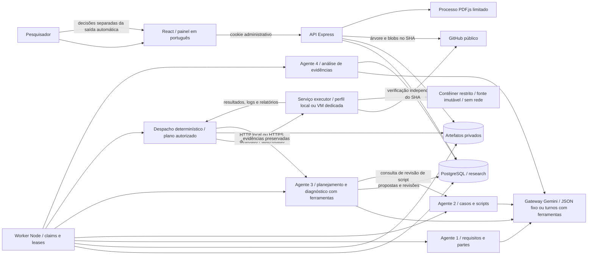
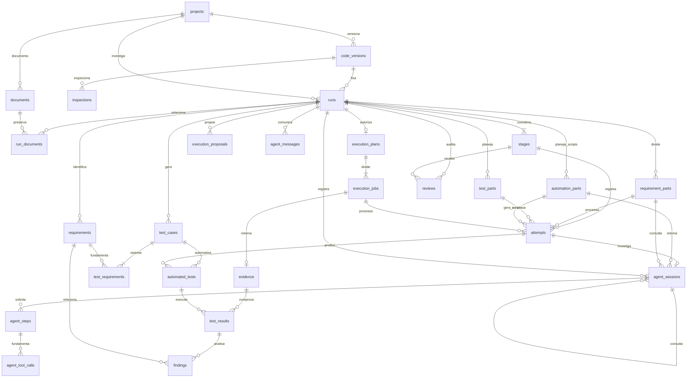
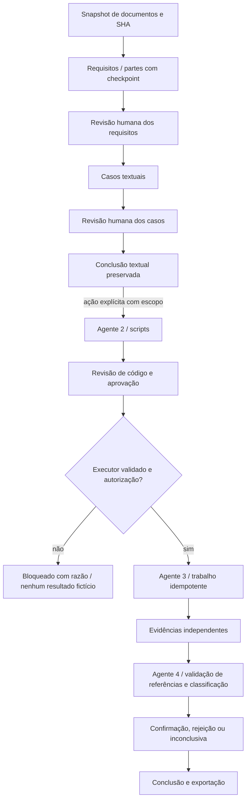

# Arquitetura da plataforma multiagente

Estado do código atualizado em 05/11/2026, até MV-02: fluxo assistido e autônomo, mapa dos agentes, histórico em sequência com snapshots e julgamento posterior. A1/A2 textual/A3/A4 e colaboração foram verificados por fixtures; o piloto técnico real anterior cobriu A2/automação. Ainda falta o piloto conjunto com LLM real das novas condições. A aplicação preserva React/Vite/Tailwind, Express, PostgreSQL e Gemini. API, worker de agentes e serviço executor têm responsabilidades separadas. As rotas atuais estão em `backend/src/research/routes.js`.

**Apresentação visual:** `agent-map.js` projeta estados determinísticos dos eventos e etapas em quatro papéis; scripts pertencem ao A2. O mapa SVG distingue ordem prevista das etapas de consultas realmente registradas. Apenas sessões/consultas ativas são animadas, respeitando preferência de movimento reduzido; falhar no A1 deixa papéis não iniciados nesse estado. No celular, os quatro nós ocupam duas linhas. O resumo atual traduz nomes de ferramentas/turnos em atividades curtas, sem gerar outra chamada ao modelo ou apresentar pensamento interno. O histórico usa quatro linhas de vida e setas pedido/resposta; clicar abre o snapshot num painel lateral com teclado/foco controlados. A navegação temporal é explicitamente histórica e não anima trabalho passado. JSON, hashes e avaliações ficam sob demanda. Atualização usa o SSE existente, com consulta ao banco a cada aproximadamente 1,5 s, sem prometer streaming de tokens.

O diagnóstico seguro de falha é vinculado à tentativa/etapa interrompida. HTTP 503 em `model_turn` é apresentado como indisponibilidade do provedor, sem atribuir falha funcional ao projeto. Retomar continua sendo uma ação explícita, mantendo orçamento e histórico. Uma falha posterior não herda a causa de uma tentativa antiga. Essa instrumentação visual não altera os contratos dos agentes, o escopo autorizado ou a condição experimental.

## Autonomia, acompanhamento e julgamento

O [plano AH-00–04](PLANO_EXECUCAO_AUTONOMA_HISTORICO.md) define duas condições imutáveis por análise. `assisted/v1` mantém revisão/correção e aprovação entre etapas. `autonomous/v1` avança A1 → A2 textual/scripts → planejamento/execução/diagnóstico A3 → A4, usando a autorização inicial do SHA/inspeção/módulo/ambiente e limites de um ciclo. O controlador `autonomy.js` usa advisory lock por análise e recupera transições prontas após reinício; as tarefas continuam sob leases existentes. Mudança do ambiente encerra a condição sem novo envio. Propostas de revisão ficam separadas e não são aplicadas/reexecutadas automaticamente.

`processing_status=eligible` permite consumir artefatos admitidos pelos contratos da plataforma exclusivamente na condição autônoma; `review_status` continua humano. Não criar aprovação ou revisão administrativa fictícia para avançar. As tabelas de responsabilidades abaixo descrevem a intervenção do modo assistido; na condição autônoma, avaliar depois os snapshots de cada etapa. Decisões posteriores não reabrem tarefas nem reescrevem as saídas originais.

`run_events` registra ordem/correlação, autoria e vínculos reais de tarefas, sessões, ferramentas, consultas, admissões e falhas. `artifact_snapshots` preserva conteúdo privado com hash e mapeamentos de códigos/versões; eventos antigos não consultam só a linha atual. API paginada e SSE com retomada pelo cursor alimentam a mesma linha do tempo. Os nós do mapa mostram sessões ativas, inclusive um A1 atendendo consulta após terminar sua etapa. A interface filtra conversas/artefatos/atividades técnicas/decisões e abre o conteúdo preservado ao clicar. Históricos anteriores são identificados como legado e usam somente referências/timestamps disponíveis. Uma consulta completa é um ciclo, distinto de turno de modelo, lote ou retentativa técnica.

`experiment_assessments` recebe julgamentos posteriores anexados sobre a análise ou um snapshot, com justificativa e referência informada. Não altera requisito/caso/script/resultado nem prova independência do julgador. JSON/CSV v3 recebem campos aditivos de eventos, snapshots, resumo e julgamentos. Migrações 027–028 aplicadas com backup; o protocolo científico permanece rascunho.

**Evolução dos agentes:** A1, A2 textual/automação e A4 admitem `agent/v1`, com ferramentas e definições fixadas no snapshot. A1 consulta o catálogo documental e submete requisitos com citações verificadas; A2 textual consulta requisitos aprovados e submete cenários; A2/automação escolhe fontes de implementação e submete scripts. A3 pode planejar com ferramentas antes da autorização humana; a execução material permanece determinística. A3 também consulta evidências e propõe diagnósticos técnicos, com revisão humana e sem alterar os resultados. A3 pode consultar A2 em sessão filha sobre revisão do script. A resposta guarda rascunho versionado sem substituir o aprovado ou sua autorização. A4 consulta resultados, regras, trechos originais, casos, scripts e ambientes antes de submeter conclusões verificadas pelo contrato de evidência. A interface oferece opções A1/A2 textual/A4 e sugere agente para scripts. A exportação versão 3 inclui trajetórias e linhagem de checkpoints. O [piloto real](PILOTO_AGENTES.md) valida tecnicamente A2/automação; A1/A2 textual/A4 ainda foram verificados com fixtures. O [diário](DIARIO_IMPLEMENTACAO_AGENTES.md) separa as naturezas da evidência. Migrações 019–026 aplicadas neste ambiente com backup.

**Situação operacional:** análise, geração, execução Node/Java e avaliação possuem perfil local explícito `docker-desktop-dev`, iniciado por `npm run dev:local`, além do perfil padrão `dedicated-vm`. A imagem Node passou em 14 controles e dez cenários sintéticos reais; Java/JUnit passou nos mesmos controles e em sete cenários. O modo local registra Docker Desktop compartilhado/cgroupfs, sem alegar VM dedicada/rootless; produção o recusa. Swing, banco, bibliotecas Java externas e implantação dedicada permanecem pendentes. Fixtures continuam separadas de resultados de repositórios públicos. [Operação local](DESENVOLVIMENTO_LOCAL.md).

## Componentes

O backend não importa o runtime Docker nem cria processos de projetos. O worker recebe tarefas no PostgreSQL e usa exclusivamente o cliente HTTP(S) do executor. O serviço não tem `pg`, chave Gemini ou credenciais da aplicação. O token de transporte não entra no contêiner, nos prompts, bundles ou exportações. O launcher local passa ao serviço somente seu token/política e variáveis de sistema necessárias ao Docker; os `.env` do backend não são carregados nele.

Acorn foi acrescentado para análise estática de JavaScript; não carrega o código inspecionado. PDF.js extrai a camada textual em processo com prazo/heap limitados. Playwright é dependência de desenvolvimento para os fluxos de interface. Não há broker ou framework externo de agentes.

## Quatro agentes e subetapas

| Responsabilidade | Entrada | Saída / validação | Revisão |
| --- | --- | --- | --- |
| Agente 1 | Documentos/texto versionados, por inteiro ou em partes limitadas | Requisitos, condições, fluxos, incertezas, alertas; códigos únicos e citações existentes na página | Corrigir/aprovar/rejeitar cada requisito, depois aprovar etapa |
| Agente 2 / textual | Requisitos aprovados | Casos com passos, dados, esperado, cenário e vínculos válidos | Corrigir/aprovar/rejeitar cada caso |
| Agente 2 / `automation` | Casos aprovados e escopo técnico inspecionado no mesmo SHA | Um script por caso ou justificativa de impossibilidade; API/símbolos/imports, caminhos, SHA e esperado validados | Código editável com versão/antes/depois; aprovação separada da autorização de execução |
| Agente 3 | Scripts/revisões e capacidades no planejamento; evidências/regras/casos/scripts no diagnóstico | Propõe lotes validados e ações técnicas, podendo consultar A2; despacho material determinístico após autorização | Autorizar plano separadamente; revisar diagnóstico e resposta A2, sem aplicar rascunho ou inferir defeito automaticamente |
| Agente 4 | Requisitos/trechos originais, casos/scripts aprovados, observações e ambiente do executor | Classificação vinculada a resultado/requisito, esperado/observado preservados e citação literal da observação | Confirmar/rejeitar/inconclusiva, com justificativa e classificação humana separada |

`automation` é uma subetapa interna do agente 2, persistida na posição 5 para compatibilidade com as quatro posições anteriores. A interface mantém quatro cartões lógicos e apresenta scripts numa aba própria. Concluir o fluxo textual não afirma que testes foram executados; estendê-lo para automação exige nova ação justificada na mesma execução.

Instruções, versões e contratos estão em `agents.js`, `requirements-agent.js`, `tests-agent.js`, `evaluation-agent.js`, `agent-collaboration.js`, `automation-contract.js`, `evaluation-contract.js` e `agent-contract.js`. As versões usadas ficam registradas no snapshot/etapa/entrada de cada tentativa. No modo `fixed/v1`, o Gemini recebe dados separados da instrução e não dispõe de ferramentas. No modo `agent/v1`, A1 consulta fontes documentais, A2 textual consulta requisitos aprovados e A2/automação consulta a inspeção, prepara escopo e submete scripts. A2 textual registra intervalos de leitura: uma lacuna ou observação parcial impede considerar o requisito integralmente consultado. Todos submetem propostas para revisão; não recebem shell nem autorização para executar scripts. A resposta precisa passar pela validação local; prompt injection não concede permissões de execução ou administração.

**Colaboração:** A2 textual pode consultar A1 sobre uma regra. A resposta é produzida por perfil restrito em sessão filha, com páginas originais da regra, e devolvida como observação ao solicitante. Mensagens versão 1 preservam pergunta, resposta, requisito/revisão/hash, origem e revisão humana. Não há delegação recursiva nem escrita em aprovados. Mudança da regra exige nova análise sem aprovações reaproveitadas. Históricos/exportações incluem mensagens e sessões filhas; chamadas e tokens entram no total, mas a duração da filha não é somada novamente à do pai. São no máximo duas consultas por análise, com quatro turnos/seis ferramentas por resposta. A troca ainda foi verificada apenas com provedores programados.

## Modelo de dados efetivo

Todas as entidades abaixo ficam no schema `research`. As migrações 009–026 são aditivas/transacionais, sob advisory lock e checksum normalizado CRLF/LF. Migrações aplicadas não são renomeadas nem alteradas. Tabelas antigas não são excluídas por essas migrações; scripts/documentos exclusivos do antigo experimento foram removidos do checkout e continuam no histórico Git.

**Planos de execução:** execution_plans preserva manifesto autorizado com scripts/revisões/hashes e recibo. execution_jobs tem plan_id/sequence e orçamento de tentativas por bundle; attempts identifica o trabalho. A divisão determinística respeita limites do protocolo e fixa todos os scripts uma única vez. Evidências permanecem por trabalho. Falha de transporte/repetição conserva IDs, e A4 só é enfileirado após todos concluírem. Cancelamento conserva o subconjunto executado. Planos legados usam formato 0 e mantêm o bundle histórico; novos planos usam formato 1. O executor continua determinístico.

**A3 agentivo:** novas análises podem usar sessões de planejamento e diagnóstico, separadas por fase e subordinadas ao teto global. O plano proposto fixa o inventário consultado; autorização humana recusa versões, casos, fontes ou ambiente diferentes. Após preservar todos os resultados, A3 investiga seus contextos e pode consultar A2 por mensagem `script_review`, vinculada ao resultado/script/versão/revisão. A2 consultado tem ferramentas restritas de leitura e resposta; rascunho passa pelo contrato estático de automação e permanece separado do aprovado. São até duas consultas de script por análise, além das duas de requisitos; cada consulta A2 tem até seis turnos/oito ferramentas. Revisões humanas de mensagens e diagnóstico são exigidas antes de concluir A4. Nenhum rascunho é aplicado/executado automaticamente, e asserções ainda precisam de julgamento humano. Exportações mantêm proposta, candidato, aprovação e evidência distintos. O piloto real conjunto desses novos papéis ainda está pendente.

Chaves compostas garantem vínculos de execução/projeto para versões, documentos, scripts, resultados e análises. Requisitos/casos guardam conteúdo estruturado e estado de revisão. Scripts guardam metadados e referência aos arquivos privados, tentativa geradora, versão/revisão e compatibilidade com o contrato. Essa compatibilidade estática **não comprova compilação, execução ou correção semântica**.

`execution_plans` fixa o manifesto autorizado; `execution_jobs` fixa cada bundle/hash e recibo de política/imagem, com repetição idempotente do transporte. `evidence.origin` aceita somente executor. Não existe endpoint para importar um JSON arbitrário como execução real. Resultados individuais ficam vinculados a script, caso e evidência. `findings.content` preserva a proposta do agente; `review_status` e `human_classification` não a sobrescrevem. Revisões registram antes/depois, data, justificativa e ator administrativo.

PDFs, extrações, fontes, código gerado, snapshots, respostas e relatórios ficam em arquivos privados com UUID, tamanho e SHA-256. PostgreSQL armazena metadados/referências. Exportações resolvem arquivos e versões humanas dos scripts para permitir auditoria sem depender somente de chaves locais.

## Entrada e inspeção do código

Projetos aceitam somente URL HTTPS pública em `github.com/owner/repo`. API resolve branch/tag/ref para SHA de 40 caracteres por `api.github.com`, sem credenciais, redirects, clone ou execução. Salvar alterações cria outra versão de código. Cada execução fixa uma dessas versões, os documentos e o texto complementar.

A inspeção lê árvore no SHA e blobs regulares, verificando hash Git e SHA-256. Leitor v2.1 organiza lotes de 24 arquivos, com quatro leituras simultâneas. Limites globais: 5000 entradas de árvore, profundidade 8, 512 arquivos, 30 mil bytes por arquivo e 2 MiB no total. Após 60 s não inicia novas leituras; uma requisição já iniciada tem timeout de 12 s. Cache da inspeção anterior no mesmo SHA só é reutilizado após conferir tamanho e hashes; não substitui a consulta da árvore. `read_batches` registra caminhos e reaproveitamentos; `reader_version` distingue o leitor mantendo compatibilidade com `inspection_version:2.0.0`. Árvore truncada, arquivos grandes, erros do GitHub, caminhos não suportados e omissões são apresentados ao pesquisador.

São identificados manifestos e módulos internos, fontes, testes existentes, imports, exports JS e candidatos Java. Manifestos mais próximos delimitam módulos; manifestos ancestrais são preservados para manter semântica CJS/ESM. Símbolos Java usam inspeção lexical conservadora, sem carregar classes. Swing, SQL e dependências externas são sinais de restrição, não autorização para iniciar serviços.

O pesquisador escolhe o módulo inteiro. Planejamento valida cada fechamento candidato, registra restrições diretas/indiretas e agrupa os compatíveis. Oito alvos por escopo é um limite interno de contexto; não é uma seleção total imposta ao pesquisador. Seleção explícita de fontes continua opcional pela API. Todos os casos aprovados são selecionados por padrão, até o teto de 6000 da análise; subconjunto é opcional. Geração v1.2 usa lotes de até dois casos, orçamento de 16 mil caracteres para casos/requisitos e somente requisitos pertinentes. `automation_parts` fixa entrada, casos, estado, saída e decisões; tentativas têm FK para o lote. `scope_route` fixa a posição no plano. Casos não automatizados passam aos próximos escopos compatíveis; decisões intermediárias `deferred` não contam como impossibilidade final ou conclusão. Cada caso tem exatamente uma decisão final, com até 12000 lotes no total. O painel/exportação consolida todos os lotes, preservando falhas, checkpoints e justificativas anteriores.

Cada fechamento inclui até doze fontes locais, dezesseis fontes/manifestos e sessenta mil caracteres de contexto técnico. Dependências não inspecionadas/não provisionadas são recusadas por fonte, sem bloquear fechamentos independentes compatíveis. Revisão e bundle usam as fontes preservadas na tentativa que gerou cada script, inclusive de escopos posteriores; a união confere SHA/hashes e os limites do bundle. Entradas do gateway continuam limitadas a 180 mil caracteres; o planejador recusa contexto individual acima de 170 mil para reservar metadados, sem truncamento silencioso. A geração em lotes não altera o limite do protocolo atual de execução: vinte scripts/16 fontes por bundle, até 1 MiB e prazo de 60 s. Geração, revisão e execução possuem estados/autorização próprios.

## Adaptadores disponíveis no código

| Adaptador | Escopo inicial | Restrições |
| --- | --- | --- |
| `node-test/v2` | JavaScript ESM/CJS, exports existentes, fontes relativas/builtins permitidos e `node:test` | Sem npm install/scripts npm, TypeScript/build/transpilação ou serviços; arquivos gerados explícitos, sem descobrir testes antigos |
| `java-junit/v1` | Classes selecionadas com JDK/dependências locais e JUnit provisionado na imagem | Maven é inspecionado; plugins/downloads Maven não são executados. `javac -proc:none` e Console JUnit headless, sem Swing/banco. Resultado inicial por classe gerada/caso |

Dockerfile/runner Node foram exercitados com fixtures e no piloto público `is-number`, SHA fixo, com dois scripts gerados pelo Gemini executados realmente. O agente 4 analisou essas evidências, com revisão técnica identificada e exportação. Imagem Java e perfil dedicado ainda precisam de validação própria. Nenhum adaptador é anunciado operacional apenas por ser reconhecido na inspeção.

## Documentos extensos e consolidação

Upload: PDF/TXT/MD, até 10 MiB e 200 mil caracteres extraídos por documento, PDF até 200 páginas; vinte versões/100 MiB de arquivos por projeto. Parser com até dois processos simultâneos, heap 128 MiB e prazo 15 s. Não há OCR ou interpretação de diagramas; páginas sem/pouco texto recebem avisos.

Seleções até 24 mil caracteres e 40 páginas usam uma chamada de análise. Acima de qualquer desses limites são planejadas partes por página/trechos, com no máximo 6000 caracteres por segmento, orçamento de 8000, até 40 fragmentos por grupo e sobreposição de 600. Documento, página e offsets UTF-16 são preservados. Páginas vazias continuam registradas; parte inteiramente vazia recebe alerta determinístico identificado, sem chamada ou tokens inventados.

O agente 1 v1.1 recebe `source_catalog`: trechos literais contíguos de até 650 caracteres, IDs e offsets. A resposta referencia IDs; o servidor recupera documento/página/citação e valida contra a entrada preservada. `raw` permanece intacto; `validated_output` e `citation_method` guardam a resolução determinística. Não se aceitam citações aproximadas ou reescritas. Presença literal não garante interpretação correta: a revisão humana permanece necessária.

Cada parte é um claim independente e tem sua entrada, saída e metadados na tentativa correspondente. Checkpoints concluídos não são repetidos após erro/interrupção. Há até três sessões de tentativa da etapa e até três tentativas por parte; número de chamadas não é o contador de retomadas. O contador sequencial de `attempts` pode ultrapassar três nesse processamento.

Após falha com checkpoints válidos, a continuação justificada cria outra execução ligada por `runs.resumed_from_run_id`. Mantém snapshot, documentos, SHA, modelo e parâmetros originais; a nova etapa registra suas instruções atuais. Checkpoints validados reutilizam artefatos e `requirement_parts.reused_from_part_id`; apenas partes restantes são redivididas. A execução anterior e o limite de três sessões permanecem preservados. Links no painel permitem consultar ambas. O JSON exporta também entradas/saídas/metadados das tentativas reaproveitadas, separadas das novas chamadas e seus custos.

Consolidação preserva respostas originais, une somente conteúdo idêntico, combina fontes dentro do limite contratual e cria mapeamento de códigos locais/globais. Descrições iguais com conteúdo complementar diferente geram candidatos a duplicação; negações lexicais opostas geram alerta de possível contradição. Isso não é uma consolidação semântica universal: referências distantes, ambiguidades e redundâncias precisam de revisão humana.

Limites globais explícitos: 4,1 milhões de caracteres selecionados, 512 partes, 2000 requisitos consolidados e 12 MiB por artefato. O processamento não envia o documento inteiro fora do orçamento nem descarta páginas para caber no contexto.

## Coordenação e revisão

O agente 2 textual v1.1 planeja lotes com até quatro requisitos, orçamento de dez mil caracteres serializados e até 2000 lotes por execução. Requisito indivisível maior fica sozinho, limitado a 120 mil caracteres; não há truncamento silencioso. A entrada contém conteúdo integral dos requisitos e identidade do código, sem os metadados extensos de inspeção. A resposta deve vincular cada requisito do lote a um caso válido; JSON válido/`STOP` sem esses vínculos é recusado, assim como `MAX_TOKENS`. Instrução solicita cenários positivos/negativos/limites sustentados pelas regras, sem inventar resultados para ambiguidades.

`test_parts` guarda entrada, saída, estado, requisitos-alvo, contador e mapeamento código local → global/UUID; `attempts.test_part_id` vincula cada chamada. Um claim processa um lote, preservando checkpoints concluídos. Casos são persistidos por lote com códigos únicos, até 6000 por execução. Revisão abre somente após todos os lotes ativos concluídos e todos os requisitos com cenário. Complementação explícita processa apenas requisitos sem casos não rejeitados, mantendo casos/revisões/respostas anteriores; lotes substituídos ficam cancelados. Aprovação textual e início de automação exigem caso aprovado para cada requisito, inclusive no legado. `test_coverage` expõe matriz e contagens de vínculos gerados/aprovados; não certifica qualidade ou cobertura semântica.

O índice parcial admite uma execução ativa por projeto. Claims usam locks e `SKIP LOCKED`; inferência não mantém transação aberta. API retorna 202 para geração/execução autorizada. Worker consulta a cada 2 s; painel a cada 4 s durante estados ativos. Inferência tem prazo de 90 s no SDK/95 s no worker; lease de 180 s. Cancelamento invalida o token da lease e é monitorado pelo worker. Resposta tardia preserva metadados sem reabrir a execução.

Etapas falhas admitem repetição justificada, até três sessões, preservando histórico. Expiração marca tentativas interrompidas e permite retomar explicitamente. API e worker não usam comandos do LLM. Edição humana exige a revisão numérica corrente; após aprovar uma etapa seu conteúdo fica congelado. Scripts podem ser corrigidos antes da autorização, com versões anteriores preservadas.

Requisitos/casos permitem salvar correções como decisão `edited`, mantendo o item pendente e registrando antes/depois. Uma aprovação humana em lote valida todos os IDs/revisões exibidos e os conteúdos aceitos, aprova pendentes e conclui a etapa na mesma transação. Rejeitados/aprovações anteriores são preservados; cada nova aprovação gera auditoria, e a etapa registra `approval_mode:'bulk'`. Exige pelo menos um item aceito. Dados obsoletos ou inválidos revertem a operação inteira; duas solicitações simultâneas não avançam duas vezes. O painel oferece observação opcional com descrição padrão da ação humana e bloqueia aprovação enquanto houver correções não salvas. Requisitos enfileiram casos; casos abrem a aba Scripts, mantendo separadas geração de scripts e autorização de execução.

## Executor e evidências

O perfil padrão `dedicated-vm` exige VM Linux, Docker rootless/seccomp/cgroups v2-systemd, token, TLS e imagens fixadas. O perfil explícito `docker-desktop-dev` permite o serviço no computador de desenvolvimento com Docker Desktop/Linux/cgroups v2/seccomp, somente em loopback e fora de produção. Não exige rootless/systemd, mas conserva os mesmos probes de limites efetivos, UID/capacidades/no-new-privileges, root read-only, fontes protegidas, rede e ausência de socket/segredos. JDK/JUnit têm versão/hash conferidos quando provisionados. A API confere identidade, política, validade, imagem e perfil; cada evidência preserva perfil/runtime e `development_only`. Não há recibo fictício para liberar execução.

Cada contêiner: CPU 1, memória/swap 256 MiB, 64 processos, prazo externo 60 s, rede none, sem bind mounts ou Docker socket. Tmpfs de trabalho 64 MiB, temporário 16 MiB e projeto 2 MiB. Inicializador confiável de comando fixo recebe JSON validado, grava somente no tmpfs e sela arquivos root/0444 e diretórios 0555 antes de enviar a entrada ao runner. Essa preparação usa UID 0 sem capacidades; testes/runner usam UID 1000 e raiz read-only. Não utiliza `docker cp`, recusado pelo daemon nessa configuração. Código do projeto não pode substituir runner/reporter. Entrada Node confiável importa somente o arquivo gerado selecionado e transforma erros de importação em eventos estruturados; `commands.test_file` preserva seu caminho. Sem teste registrado, resultado inconclusivo. A suíte antiga não é descoberta.

O serviço verifica fontes contra a árvore GitHub do SHA, aceita bundle até 1 MiB/relatório até 2 MiB, uma execução de cada vez, oito pendentes e 128 journals. UUID/hash são idempotentes. Contêineres são removidos em finally; falha de limpeza bloqueia também a fila pendente. Recuperação limpa trabalhos interrompidos e não os reexecuta automaticamente. Timeout preserva logs parciais e informa eventos/comandos não recuperados. Detalhes operacionais: `executor/README.md`.

São distintos: passed, failed, test_error, compilation_error, infrastructure_error, dependency_unavailable, timeout, cancelled, unsupported, inconclusive e skipped. Falha de transporte não produz evidência fictícia. Retorno válido é conferido contra bundle/SHA/imagem/política e persistido antes de enfileirar o agente 4.

## Avaliação e métricas

O agente 4 só recebe resultados persistidos de origem executor e precisa cobrir os pares resultado/requisito. Não pode alterar esperado/observado nem citar resultados de outra execução. Compilação, dependência, infraestrutura, timeout e ausência de evidência não sustentam divergência funcional. Passed permite compatibilidade limitada ao cenário, não correção global. Observação acima de oito mil caracteres é referenciada por trecho explícito; original completo continua no artefato e a avaliação fica inconclusiva quando houver omissão.

Métricas coletadas: quantidade de itens/estados, revisões, tentativas, duração, exit codes, comandos/ambiente, resultados individuais, tokens/versão do modelo quando informados. Custo ausente é null. Não há precisão/recall, cobertura completa, confiança calibrada ou prova automática de defeito. A decisão humana não sobrescreve a proposta do modelo.

## Operação e limites reais

API e worker compartilham banco e diretório absoluto de artefatos; backup deve incluir ambos. Executor usa armazenamento/journals próprios e não recebe acesso a eles. Há um administrador, sem RBAC multiusuário. Downloads/exportações exigem sessão administrativa; escritas verificam origem, cookies são HTTP-only e produção exige HTTPS. Banco remoto verifica TLS.

Não há quota global/retencão automática de artefatos da API. Falha de persistência pode deixar arquivos órfãos; não apagar sem cruzar referências/backups. Listagem global limita execuções a 500, com histórico por projeto; contagens do dashboard consultam todo o banco. Modelos não são determinísticos e aliases podem mudar: para auditoria, preserve commit/lockfiles da plataforma, instruções, snapshots, metadados e respostas originais.

O fluxo técnico Node foi validado de ponta a ponta no perfil local, usando repositório público e oráculo sintético. Isso não substitui protocolo/avaliação humana independente da pesquisa. Consulte `PILOTO_EXECUCAO.md` e `VALIDACAO.md` para separar esse piloto, fixtures, suporte Java e validação dedicada ainda pendente.

## Jornada e recuperação de indisponibilidade — atualização de 05/11/2026

O frontend abre cada análise em um resumo orientado à próxima ação, calculada a partir dos estados persistidos. Requisitos, casos, scripts do A2, execução, resultados, mapa/sequência e registros mantêm as URLs por `view`. Etapas futuras explicam a dependência antes de mostrar formulários. Router com bloqueio de navegação protege correções de requisitos/casos e scripts; recarga também alerta sobre conteúdo não salvo. A página de resultados permite julgamento posterior sem substituir a proposta do modelo.

Clientes podem enviar `operation_record:'system/v1'` somente nos contratos operacionais de geração de scripts, planejamento, complementação, continuação e retomada. O servidor produz a descrição e registra `operation_requested` com origem sistema e solicitante pesquisador; não registra aprovação humana. Clientes antigos com justificativa conservam o comportamento anterior. Os endpoints de revisão e autorização de código continuam exigindo sua justificativa e verificações originais. A interface usa finalidade selecionada conscientemente e confirmação do escopo nas autorizações; o backend preserva o manifesto real.

A política agentiva 1.1.0, congelada em novas análises, permite no máximo quatro envios do mesmo turno para HTTP 429/502/503/504, com esperas de 5/10/20 s. Cada envio usa `beginStep` e consome os limites existentes. `failStep` preserva status seguro, marca consumo desconhecido e salva checkpoint/espera atomicamente sob a lease. `model_retry_scheduled` e `model_turn_failed` aparecem no histórico; reenvios efetivos são contados separadamente das tentativas da etapa. Ferramentas concluídas não se repetem. Espera aceita cancelamento e respeita o prazo total. Política 1.0.0, snapshots sem política e chamadas fixas não recebem retries retroativos. SDK continua com uma tentativa por chamada; não há retries ocultos nem troca de modelo. Retry-After não está exposto pelo gateway atual. Mais detalhes e verificações em `REFATORACAO_UX.md` e no diário.
