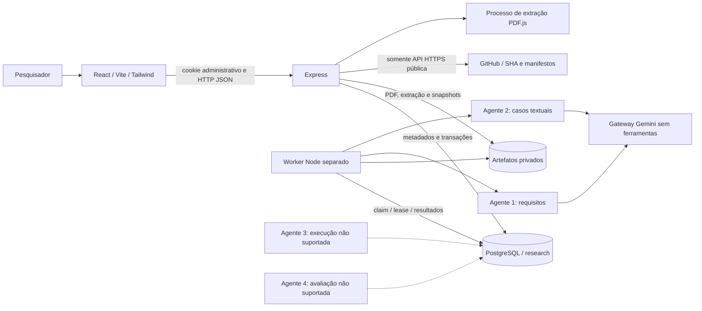
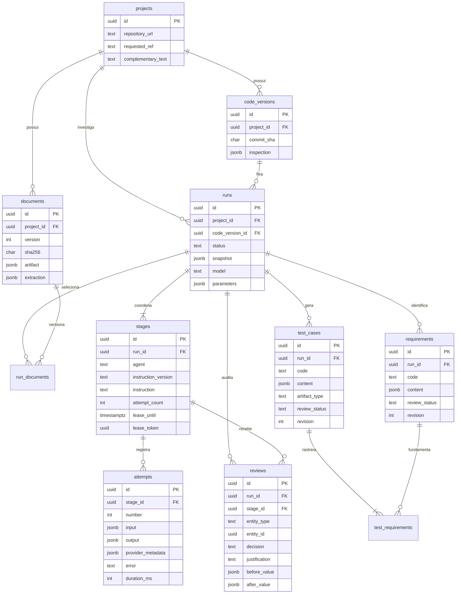
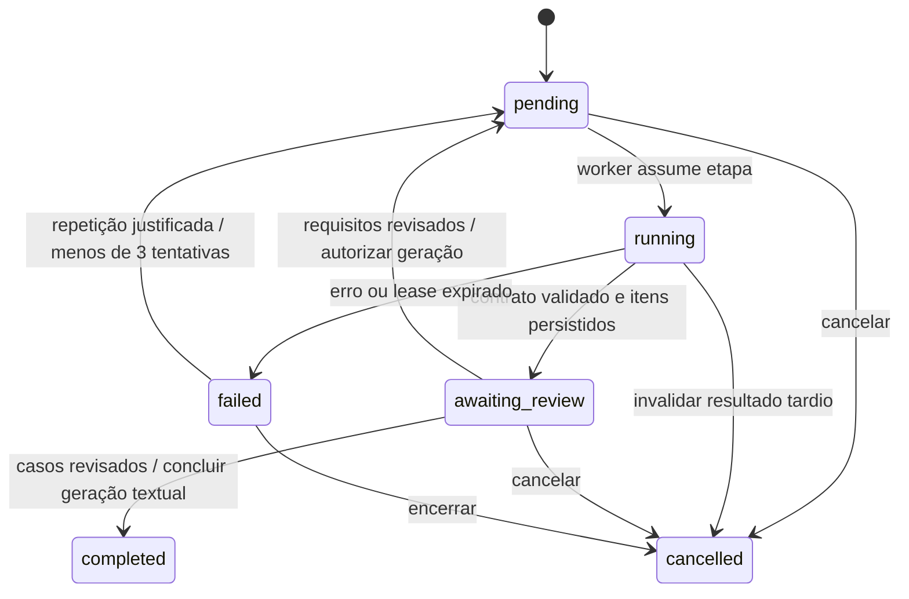

# Arquitetura implementada

Esta documentação descreve a primeira base funcional, em 30/10/2026. As rotas ativas estão em `backend/src/research/routes.js`; o domínio não depende das tabelas de participantes. Módulos antigos de código permanecem fora do fluxo ativo. Documentos e scripts SQL exclusivos do experimento anterior foram removidos e podem ser consultados no histórico do Git.

## Componentes e comunicação

O Express responde `202` ao criar uma execução, depois de capturar entradas locais e gravar o snapshot; não aguarda inferência. Um worker independente consulta o PostgreSQL a cada dois segundos, processando uma etapa por vez. Mais de um worker pode compartilhar banco e artefatos: locks de linha e `SKIP LOCKED` evitam claims duplicados. Não há broker, framework de agentes, shell de projetos, clonagem ou Docker socket.

PDF.js é a única dependência de domínio adicionada à execução do backend, justificada pela extração por página. Playwright é uma dependência de desenvolvimento, para validação do fluxo no navegador. A configuração existente do Gemini, autenticação, pool `pg`, Axios e componentes visuais básicos foram reaproveitados. O antigo serviço de geração livre não é usado pelo novo orquestrador.

## Modelo de dados real

Todos os nomes abaixo pertencem ao schema `research`. UUIDs são produzidos na aplicação. Conteúdo estruturado dos requisitos/casos usa JSONB validado; relacionamentos essenciais têm FKs, inclusive vínculos que precisam pertencer à mesma execução/projeto.

Não foram criadas tabelas de execuções de código, evidências de teste ou divergências funcionais: esses dados ainda não podem ser obtidos com segurança. `attempts` contém registros de processamento dos agentes, que **não equivalem a evidências de comportamento do software analisado**. `artifact_type` aceita apenas `textual` nesta versão. A referência polimórfica de `reviews.entity_id` é validada pelo serviço; `run_id`/`stage_id` têm FK composta.

## Entrada e versionamento

1. Um administrador informa URL HTTPS de repositório público em `github.com/owner/repo`, nome, referência e campos complementares.
2. A aplicação consulta somente `api.github.com`, sem credenciais, redirecionamento ou clonagem. A branch padrão é usada quando a referência está vazia. O SHA de 40 caracteres retornado é persistido em `code_versions`.
3. Salvar alterações no projeto resolve novamente a referência e cria outra versão; não modifica o SHA das versões existentes. O pesquisador pode escolher uma versão antiga ao iniciar a análise.
4. PDF/TXT/MD é enviado como corpo binário, com `Content-Type` e `X-File-Name` codificado. Conteúdo, nome e limites são verificados. Cada upload recebe UUID, SHA-256 e versão crescente para o mesmo nome no projeto.
5. O original e a extração JSON por página são armazenados fora do diretório público. PostgreSQL guarda chave, tipo, tamanho e hash. Downloads exigem administrador e vínculo com o projeto.
6. Uma execução seleciona documentos e versão de código. A interface pré-seleciona a versão mais recente de cada nome. O snapshot inclui textos completos selecionados, avisos, texto complementar, metadados do projeto, SHA e definições dos agentes.

PDF: até 10 MiB, 200 páginas e 200 mil caracteres extraídos por documento; até dois parsers simultâneos por processo, 128 MiB de heap e 15 segundos. Até 20 versões de documentos e 100 MiB por projeto. Uma análise admite até 100 mil caracteres de fonte, sem truncamento silencioso; entradas serializadas do gateway têm limite adicional de 180 mil caracteres. O parser não recebe credenciais nem ambiente da aplicação. Ele é uma defesa para tratar documentos, não um executor de código de projetos externos.

Sem OCR, interpretação de diagramas ou garantia de ordem correta de leitura. Páginas com pouco texto e documentos vazios recebem avisos; documento sem texto utilizável não permite analisar uma entrada inteiramente vazia. Cabe ao pesquisador transcrever informações não extraídas e conferir o documento original.

## Contratos e responsabilidades

| Etapa | Entrada | Saída e validação | Situação |
| --- | --- | --- | --- |
| Requisitos | Páginas selecionadas e texto complementar | Requisitos, atores, fluxos, condições, critérios, incertezas e alertas. Código único; documento/página existentes; citação literal conferida após normalização de espaços | Operacional via Gemini |
| Casos de teste | Conteúdo dos requisitos aprovados e versão de código | Objetivo, pré-condições, dados, passos, esperado, cenário e viabilidade. Códigos únicos e somente referências a requisitos aprovados; artefato textual | Operacional via Gemini |
| Execução | Futuramente artefatos executáveis aprovados e configuração isolada | Comandos, ambiente, logs e resultados reais | `not_supported` |
| Avaliação | Futuramente requisitos, casos e evidências independentes | Classificações justificadas e validação humana | `not_supported` |

`agents.js` define instruções, schemas e validadores. O modelo recebe a instrução de sistema separada dos dados, sem ferramentas. O schema enviado ao provedor reduz limites de complexidade; o contrato completo é aplicado localmente antes de qualquer inserção de requisitos/casos. A proteção contra injeção de prompt não garante correção semântica: não concede privilégios ao modelo, verifica referências e exige revisão humana.

O gateway registra modelo solicitado e versão retornada quando disponível, identificador de resposta, motivos de término e uso de tokens reportado. Os parâmetros iniciais são `temperature=0.2` e `maxOutputTokens=8192`, preservados por execução. Custo não informado é `null`. Aliases do modelo podem mudar no provedor; registrar a versão retornada melhora a rastreabilidade, mas não garante inferência determinística.

## Coordenação e revisão

O índice parcial admite uma execução ativa por projeto (`pending`, `running`, `awaiting_review`). A claim, criação de tentativa e mudança de estado são atômicas. A inferência acontece fora da transação, com timeout/abort; a conclusão verifica o token da lease antes de inserir resultados. A etapa permite até três tentativas, com repetição explicitamente solicitada e justificada. Não há retry pago automático do orquestrador; retries HTTP do SDK estão limitados a uma tentativa.

Prazo do modelo: 90 s no SDK e 95 s no worker. Lease: 180 s. O worker detecta leases expiradas, marca tentativa interrompida e execução falha; exige decisão explícita antes de repetir. Respostas tardias podem ser anexadas à tentativa original, sem reabrir uma execução cancelada ou recuperada. Uma chamada já enviada pode terminar e consumir tokens no provedor após cancelamento local.

Cada requisito/caso exige aprovação ou rejeição com justificativa. Correções preservam o código, validam fontes/vínculos e criam revisão com antes/depois, responsável `admin` e data. O contador de revisão rejeita uma edição obsoleta. Todos os itens precisam de uma decisão e pelo menos um aprovado para concluir a etapa. Após sua aprovação, requisitos não podem mais ser alterados naquela execução. O segundo agente usa apenas aprovados; rejeitados permanecem no histórico.

`completed` indica conclusão da **geração e revisão textual**, enquanto execução e avaliação continuam não suportadas. O painel apresenta os quatro estados separadamente.

## Adaptador inicial e infraestrutura pendente

`adapters.js` consulta somente `package.json` e `pom.xml` na raiz do SHA, com limites de tamanho. O adaptador declarativo `node-built-in-test/v1` reconhece apenas o script exato `node --test`, sugere o vetor fixo `['node','--test']` e lista possíveis dependências conhecidas de serviços. Não interpreta nem executa scripts do repositório. Maven é identificado sem execução. Monorepos e interfaces gráficas precisam de extensão específica.

O adaptador **não é um runner**. Não há imagem Docker, sandbox provisionada, instalação de dependências, geração de scripts ou coleta de evidências de testes. Para habilitar futuramente: trabalhador de execução separado da API/IA, imagem imutável, usuário sem privilégios, sem socket/credenciais/mounts do host, rede restrita, limites de CPU/memória/pids/tempo/disco, validação dos artefatos e aprovação humana anterior à execução. Esses controles precisam de validação prática antes de qualquer habilitação. A indisponibilidade não pode ser contornada por parâmetro de ambiente ou conteúdo do projeto.

## Persistência, operação e limitações

- Banco e artefatos devem ter backup consistente. Backend e worker precisam do mesmo diretório absoluto de artefatos e das mesmas credenciais de banco/modelo. Nenhum diretório de artefatos deve ser servido como estático.
- As migrações são transacionais, bloqueadas por advisory lock e verificadas por checksum. Bancos novos e existentes usam somente `npm run migrate`, que aplica os arquivos em `database/migrations`. A numeração de migrações já aplicadas é preservada.
- HTTPS entre navegador/API é necessário em produção. Cookies administrativos HTTP-only duram oito horas; modo de produção usa `Secure` e `SameSite=None`. Origem esperada é validada nas escritas. Clientes sem header Origin são admitidos, desde que autenticados.
- Há um administrador por configuração, sem RBAC multiusuário ou identidades distintas para revisores. Um worker processa uma etapa por vez. Não há paginação de projetos; listagem global limita execuções a 500 mais recentes, com histórico completo disponível por projeto. Os indicadores do dashboard são agregados diretamente sobre todo o banco, independentemente desse limite de listagem.
- O armazenamento limita arquivos e documentos por projeto, mas ainda não há quota global de disco ou política automatizada de retenção. Falha de disco/banco pode deixar artefatos órfãos; não os apague sem conferir as referências e backups.
- PDF/TXT/MD são processados sob demanda; a extração PDF pode manter a requisição de upload aberta por até 15 s. Inferências longas ficam no worker. OCR e importação ZIP não suportados.
- O schema do contrato é preservado no snapshot e as entradas por tentativa. Para repetir versões antigas da validação, execute também o mesmo commit da plataforma com o lockfile original; o código atual do validador implementa os contratos v1.
- Precisão, cobertura de requisitos, taxa de defeitos, confiança calibrada e custo financeiro não são calculados. A plataforma registra apenas dados observados, revisões e consumo reportado pelo provedor.
