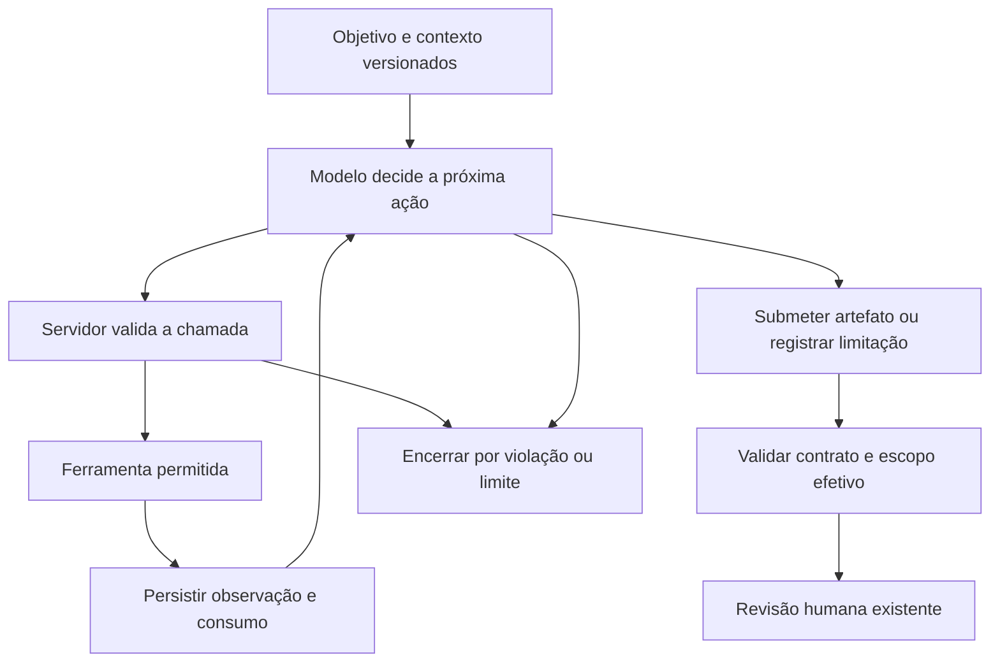

# Plano de implementação dos agentes

Data: 04/11/2026. Base inspecionada: `f1a6722`.

**Estado: M1 concluído com piloto real; M2 em implementação, com AG-10 concluída.**

O objetivo é introduzir agentes com escolha de ferramentas, observação dos resultados e decisões limitadas por tarefa, aproveitando a plataforma existente. Cada tarefa abaixo deve ser concluída, verificada, registrada no [diário técnico](DIARIO_IMPLEMENTACAO_AGENTES.md) e commitada antes da seguinte. O planejamento e o diário são documentação técnica versionada; conversas, contexto pessoal, credenciais e dados brutos locais não fazem parte deles.

## 1. Estado de partida e recorte

A aplicação usa React/Vite, Express, PostgreSQL, Gemini e um executor HTTP separado. O worker organiza etapas e lotes, registra tentativas, valida respostas e preserva artefatos com hashes. A análise de requisitos e a geração de casos dependem de revisão humana; a geração de scripts é uma subetapa do A2. A execução é determinística. O gateway atual não fornece ferramentas ao modelo.

O primeiro marco altera **somente a subetapa `automation` do A2** para que ela possa escolher fontes a consultar e produzir scripts a partir de casos e requisitos já aprovados. A geração textual do A2, A1 e A4 continuam inicialmente no fluxo atual. O marco não deve ser apresentado como quatro agentes autônomos implementados.

| Marco | Resultado esperado | Tarefas |
| --- | --- | --- |
| M0 | Plano, decisões e rotina de registro/commits | AG-00 |
| M1 | A2 de automação com ferramentas, ciclo persistido, revisão e histórico exportável | AG-01–AG-09 |
| M2 | A1, A2 textual e A4 com autonomia delimitada e colaboração rastreável | AG-10–AG-13 |
| M3 | A3 com planejamento/diagnóstico útil acima do executor determinístico | AG-14–AG-15 |
| M4 | Arquitetura estabilizada e condições prontas para coleta científica | AG-16 |

M1 deve ser validado antes de ampliar a arquitetura. Não é necessário resolver Swing, banco, instalação de dependências ou todos os requisitos do VVV para demonstrar esse primeiro marco. O piloto deverá usar um módulo real compatível e verificar uma regra de negócio, não apenas acesso a atributos.

## 2. Decisões de arquitetura

| Decisão | Implementação prevista | Motivo |
| --- | --- | --- |
| Um runtime comum, papéis separados | Sessão com objetivo, ferramentas, contexto e limites próprios por papel | Reutilizar o mecanismo sem confundir as permissões e responsabilidades |
| SDK existente | Acrescentar function calling ao gateway, preservando a chamada JSON atual | O SDK instalado já expõe chamadas/respostas de função; não é necessário acrescentar um framework neste marco |
| Dois modos explícitos | `fixed/v1` e `agent/v1`, registrados no snapshot da análise e na configuração da etapa | Preservar execuções antigas e permitir identificar as condições de uma avaliação futura |
| Contexto e versões fixados | Documento/SHA/inspeção e artefatos aprovados identificados antes da sessão | Impedir mistura silenciosa de versões e tornar as consultas auditáveis |
| Ferramentas executadas pelo backend | O modelo solicita ações tipadas; o servidor valida escopo, limites e argumentos | Separar decisão do modelo de autoridade operacional |
| Fontes consultadas sob demanda | Manifesto de fontes permitidas e leitura dos artefatos privados da inspeção | Dar ao agente uma escolha efetiva de contexto sem baixar código arbitrário durante o ciclo |
| Saída final por contrato | Submissão terminal validada pelos contratos de automação existentes | Uma chamada de ferramenta não equivale a um script aprovado ou semanticamente correto |
| Executor preservado como serviço | A3 poderá solicitar operações autorizadas; Docker/JUnit não vira LLM | Manter observações reais e comandos controlados pelos adaptadores |
| Progresso persistido | Sessões, passos, chamadas e referências a observações | Retomar interrupções e distinguir decisões, tentativas e resultados |
| Revisão continua explícita | Nenhuma submissão do agente aprova o próprio artefato | Separar geração, correção humana, autorização e avaliação |

A configuração de uma análise deve registrar o modo de cada subetapa. No M1, apenas `automation` poderá usar `agent/v1`. Snapshots antigos sem esse campo são interpretados como `fixed/v1`; não serão reescritos. Alterar o modo exige nova análise, não uma variável de ambiente que mude execuções já criadas. A escolha fica disponível na interface quando AG-08 estiver concluída; até lá, a API validada e as fixtures permitem exercitar a integração.

O modo atual permanece utilizável para regressão e eventual condição de comparação. A passagem a um novo padrão de criação só poderá ser decidida depois de AG-09, e será registrada como mudança de configuração, não aplicada retroativamente.

### Ciclo do agente

Ferramentas inválidas, chamadas sem progresso e argumentos incorretos têm respostas controladas e consomem orçamento. Um erro recuperável pode ser devolvido ao agente; violação de escopo, cancelamento e orçamento esgotado encerram o ciclo conforme a política. Um artefato só entra no fluxo normal depois da validação local e da persistência transacional prevista.

## 3. Contratos e dados previstos

Os nomes de novos arquivos e tabelas abaixo são propostas de implementação. Cada tarefa deve ajustar detalhes a testes e restrições encontrados e registrar a decisão no diário.

### Sessão e passos

- `agent_sessions`: vínculo a projeto/análise, etapa, tentativa e parte de automação quando houver; papel, modo, objetivo, instrução/contrato/política versionados, limites, orçamento consumido, estado e motivo de encerramento.
- `agent_steps`: sequência estável de interações com o modelo; referências a requisição, resposta, contexto e saída; metadados do provedor e tempos. Passos concluídos não são sobrescritos.
- `agent_tool_calls`: ID original da chamada, nome e versão da ferramenta, argumentos, observação, estado, duração e chave de idempotência. Uma resposta com várias chamadas preserva a associação entre cada chamada e seu retorno.
- Uma tentativa pode ter no máximo uma sessão ativa correspondente à sua tarefa. FKs/índices devem impedir associações entre análises e duplicação da sequência ou da chamada.
- Dados grandes permanecem no armazenamento privado com SHA-256. O banco guarda referências e os dados operacionais necessários para consultas e retomada.
- Estados detalhados ficam inicialmente nas sessões: execução, conclusão, interrupção, cancelamento, falha e esgotamento de orçamento. O mapeamento para os estados atuais de análise/etapa é explícito; não exige mudar todos os estados históricos.

Não usar a resposta intermediária de uma sessão como um resultado final da etapa. Esgotamento de orçamento não significa que o requisito é impossível de automatizar. No M1, ele deixa a tarefa incompleta/falha com motivo próprio, preservando checkpoints válidos; não preenche `unsupported_cases` artificialmente.

### Ferramentas iniciais de A2/automation

| Ferramenta proposta | Entrada e escopo | Resultado |
| --- | --- | --- |
| `list_sources` | Filtros/paginação dentro do módulo e inspeção autorizados | Caminhos, símbolos, hashes, compatibilidade e restrições; sem enviar todos os conteúdos |
| `read_source` | Caminho permitido e intervalo limitado | Trecho, hash, offsets, tamanho e indicação de truncamento |
| `find_symbols` | Consulta limitada sobre o índice estático da inspeção | Ocorrências com caminho e localização disponíveis; não executa código |
| `get_approved_case` | ID de caso atribuído à tarefa | Caso aprovado, revisão e requisitos relacionados |
| `get_approved_requirement` | ID/código relacionado aos casos da tarefa | Requisito aprovado e fontes originais autorizadas |
| `get_adapter_capabilities` | Adaptador do módulo | Limites e restrições versionados para a tarefa; disponibilidade em tempo real permanece separada |
| `prepare_automation_scope` | Fontes-alvo dentre as permitidas | Fechamento de dependências e escopo efetivo validado pelo backend |
| `submit_automation` | Artefatos/justificativas e escopo efetivo | Resultado terminal validado, sujeito à persistência e revisão existentes |

Os parâmetros não podem selecionar outro projeto/análise, outro SHA, caminhos do host ou uma URL arbitrária. Conteúdo remoto é dado, não instrução. Escrita no código do sistema analisado, shell, instalação de dependências e administração da plataforma não são ferramentas desse papel.

No M1, as ferramentas são de consulta e submissão final. Não haverá execução preliminar de script ainda não aprovado. O retorno da execução para revisão de script será desenvolvido com versionamento e autorização próprios no M3.

### Contexto lido e escopo de execução são diferentes

O agente pode consultar arquivos para entender o módulo sem incluir todos eles no bundle. `prepare_automation_scope` calcula o fechamento necessário para os alvos escolhidos. A saída terminal deve referenciar esse escopo imutável.

Hoje `execution.js` recupera `input.scope` da tentativa geradora para reunir as fontes. A integração precisa persistir o escopo efetivamente validado no formato consumido por essa cadeia, ou adaptar conjuntamente os consumidores com regressões verificadas. Não basta acrescentar ferramentas de leitura enquanto o executor continua usando o escopo antigo.

O M1 mantém os limites de um bundle: até 20 scripts e 16 arquivos-fonte. A sessão deve identificar os casos que continuam sem solução. A geração em lotes não poderá afirmar que uma suíte maior está pronta para execução apenas porque produziu vários scripts.

### Orçamento e retomada

O piloto começou com oito interações com o modelo. A calibração de AG-09 estabeleceu como padrão de criação 12 interações, mantendo 16 chamadas de ferramentas, 180 segundos por tarefa e observações de até 12 mil caracteres. A trajetória real concluída consumiu 11 chamadas, incluindo uma sem resposta preservada. Esses números são decisões de engenharia apoiadas em um piloto pequeno, não condições científicas já congeladas. Snapshots existentes mantêm seus valores explícitos.

- O prazo por chamada deve respeitar o tempo restante da sessão. O timer atual de uma operação não pode ser reutilizado cegamente para todo o ciclo.
- Lease/heartbeat e verificação do token de posse devem cobrir o ciclo completo. Nenhum retorno tardio pode reabrir uma tarefa cancelada ou finalizar uma tarefa reivindicada por outro worker.
- Retomar não zera o consumo acumulado. Deve haver também teto configurável por análise para impedir multiplicar o custo pelo número de partes ou de tentativas.
- Limites de tempo, chamadas e bytes são verificáveis antes/durante a ação. Tokens reportados pelo provedor são contabilizados depois de cada resposta e impedem novas chamadas quando atingem o teto; isso não é uma promessa de limite monetário exato.
- Reservar o orçamento antes de uma nova chamada em uma transação curta. Não manter transação aberta enquanto espera modelo ou ferramenta.
- Se uma chamada ao provedor foi enviada e não houve resposta preservada, o consumo pode ser desconhecido. Registrar a interrupção e a possível repetição cobrada; não prometer idempotência do provedor nem inventar tokens.
- Retomada recupera observações já confirmadas. Chaves idempotentes impedem persistir a submissão final ou enviar o mesmo job de execução duas vezes nos marcos em que houver efeitos externos.
- Preservar as partes de conversa exigidas pelo SDK/provedor, inclusive identificadores técnicos opacos. Não reconstruir o histórico apenas com textos resumidos, nem solicitar raciocínio interno extenso como evidência da pesquisa.

## 4. Backlog ordenado e commits

`[x]` significa tarefa concluída e verificada. `[ ]` significa pendente. Cada item corresponde a uma entrega com seu próprio commit, incluindo atualização do diário e documentação afetada. Os assuntos abaixo são sugestões para facilitar a consulta ao histórico.

### M0 — Preparação

- [x] **AG-00 — Documentar o plano e iniciar o diário.**
  - Entrega: este documento, diário, links no README e indicação de planejamento na documentação de arquitetura.
  - Verificação: conferir links e arquivos mencionados, escopo do diff, `git diff --check` e ausência de alterações de código/dados.
  - Commit: `docs(agents): planeja implementacao e inicia diario tecnico [AG-00]`.

### M1 — Primeiro agente operacional: A2/automation

- [x] **AG-01 — Definir contrato do runtime e política versionada.** Depende de AG-00.
  - Arquivos previstos: novos `backend/src/research/agent-contract.js`, `agent-policy.js` e testes unitários correspondentes; instrução agentiva de automação separada da atual.
  - Entrega: tipos de ação, submissão terminal, estados/motivos, catálogo permitido, configuração dos modos e limites com validação. Definir um exemplo completo de chamada/observação/submissão.
  - Aceite: contrato rejeita ferramenta desconhecida, orçamento inválido e IDs fora da tarefa; ausência de configuração em snapshot antigo resolve para `fixed/v1`.
  - Verificação: testes dos limites e das transições com dados válidos e inválidos, sem Gemini.
  - Commit: `feat(agents): define contratos e politica do ciclo [AG-01]`.

- [x] **AG-02 — Persistir sessões, passos e chamadas.** Depende de AG-01.
  - Arquivos previstos: próxima migração aditiva, inicialmente `database/migrations/019_agent_sessions.sql`, novo `agent-sessions.js`, testes de integração e `database/README.md`.
  - Entrega: estrutura descrita na seção 3, vínculos consistentes, sequência/idempotência e operações transacionais curtas para reivindicar/registrar/concluir passos.
  - Aceite: migração reexecutável, histórico antigo legível, vínculo entre análises recusado e submissão/retomada concorrente sem duplicação.
  - Verificação: PostgreSQL exclusivamente em banco `tcc_test_*`, com rollback/concorrência e preservação de referências aos artefatos. Não aplicar ao banco da pesquisa nessa tarefa automaticamente.
  - Commit: `feat(agents): persiste sessoes e chamadas auditaveis [AG-02]`.

- [x] **AG-03 — Acrescentar function calling ao gateway Gemini.** Depende de AG-01.
  - Arquivos previstos: `model.js`, novo adaptador se necessário e `backend/test/model.test.js`.
  - Entrega: operação de um turno agentivo, preservando a operação JSON existente; transporte das declarações de ferramentas, partes/IDs retornados e observações; metadados por chamada.
  - Aceite: suporta múltiplas chamadas numa resposta, associa retornos corretamente, respeita abort/timeout e preserva resposta inválida/recusa/término por limite. Não mistura configuração incompatível de schema JSON com ferramentas.
  - Verificação: SDK injetado com respostas representativas; regressão do gateway atual. Conferir os tipos da versão instalada antes de escolher campos concretos.
  - Commit: `feat(gemini): adiciona turnos com chamadas de ferramentas [AG-03]`.

- [x] **AG-04 — Implementar as ferramentas de consulta e o escopo efetivo.** Depende de AG-01 e AG-02.
  - Arquivos previstos: novos `agent-tools.js` e `automation-agent-tools.js`; reutilizar `inspection.js`, `automation-contract.js`, citações e artefatos sem executar fontes.
  - Entrega: ferramentas da seção 3, respostas limitadas/paginadas, hashes e escopo calculado a partir das dependências reais da inspeção preservada.
  - Aceite: leitura no SHA/inspeção da tarefa, limites de bytes e paths, recusa de itens de outra análise; fontes consultadas separadas das fontes executáveis. Submissão não grava script aprovado.
  - Verificação: testes de autorização, truncamento, consulta de símbolo, fechamento de dependências e casos não suportados. Dados/documentos com instruções embutidas não alteram permissões do registro de ferramentas.
  - Commit: `feat(agents): oferece ferramentas de consulta ao A2 [AG-04]`.

- [x] **AG-05 — Implementar o ciclo persistido e sua retomada.** Depende de AG-02, AG-03 e AG-04.
  - Arquivos previstos: novo `agent-runtime.js`, repositório de sessões e testes unitários/de integração.
  - Entrega: objetivo → turno → ferramenta → observação → próxima decisão; parada, abort, lease e orçamento por sessão/análise.
  - Aceite: ciclo com consulta adicional e conclusão; chamadas múltiplas; erro recuperável; parada por limite; cancelamento; queda após ferramenta e antes da próxima resposta; worker concorrente e retorno tardio sem efeitos duplicados.
  - Verificação: relógio/provedor/ferramentas injetáveis e PostgreSQL de teste. Provar que retomada não apaga falha anterior nem zera o orçamento.
  - Commit: `feat(agents): executa ciclo limitado com checkpoints [AG-05]`.

- [x] **AG-06 — Integrar A2/automation ao fluxo existente.** Depende de AG-05.
  - Arquivos previstos: `runs.js`, `processor.js`, `automation.js`, `automation-parts.js`, contratos e fixtures em `backend/test-support`.
  - Entrega: seleção de modo no snapshot; rota agentiva de automação com casos aprovados; saída e escopo efetivo compatíveis com persistência, revisão e executor existentes.
  - Aceite: as consultas e escolhas do agente substituem a passagem obrigatória por escopos predefinidos no modo agentivo. `fixed/v1` continua com seu comportamento; não há fallback silencioso entre condições.
  - Verificação: integração com duas análises equivalentes em modos distintos, script correto, submissão inválida, impossibilidade sustentada, orçamento esgotado e retomada preservando scripts já válidos. Conferir que o bundle usa as fontes escolhidas e validadas.
  - Commit: `feat(automation): integra agente de geracao de scripts [AG-06]`.

- [x] **AG-07 — Expor histórico e exportar a trajetória.** Depende de AG-06.
  - Arquivos previstos: `runs.js`, `routes.js`, `export.js`, testes de acesso/exportação e documentação da API.
  - Entrega: consulta paginada de sessões/passos/ferramentas e exportação JSON/CSV com versão de formato, modos, limites, consumo, motivos e referências resolvidas.
  - Aceite: distinguir turno de modelo, tentativa, sessão, artefato, intervenção humana e resultado de execução; incluir erros/interrupções, preservar exportação de análises antigas e não expor segredos.
  - Verificação: exportar/reler uma trajetória com falha e recuperação, confirmar integridade e vínculos e checar os tipos de registro CSV. Testar acesso restrito ao pesquisador.
  - Commit: `feat(research): exporta trajetorias dos agentes [AG-07]`.

- [x] **AG-08 — Mostrar decisões e estados na interface.** Depende de AG-07.
  - Arquivos previstos: `ResearchProjectPage.jsx`, `ResearchRunPage.jsx`, `ResearchAutomationPanel.jsx`, novo componente de trajetória, serviço de pesquisa e E2E.
  - Entrega: escolha do modo ao criar a análise e visualização da trajetória, consultas, consumo e motivo de encerramento. Mostrar “artefato gerado”, “revisado” e “executado” como fatos diferentes.
  - Aceite: seleção fica fixada na análise; interface mostra progresso/limite/cancelamento; analisa exportação e histórico antigo; funciona em tela pequena. Ferramentas e detalhes técnicos aparecem na inspeção do histórico, sem sobrecarregar o fluxo principal.
  - Verificação: lint/build e E2E com fixtures: consulta → geração → revisão; encerramento por limite e cancelamento, sem chamadas pagas.
  - Commit: `feat(frontend): apresenta modo e historico dos agentes [AG-08]`.

- [x] **AG-09 — Validar M1 e registrar um piloto técnico real.** Depende de AG-08.
  - [x] **AG-09a — Corrigir classificação de testes legados, esclarecer escopo e fixar catálogo por análise.** Subtarefa surgida no piloto real: leitor 2.2.0, instrução agent/1.0.1 e definição/ferramentas preservadas no snapshot. A primeira tentativa permanece registrada como falha de escopo.
  - [x] **AG-09b — Registrar diagnóstico seguro de falhas de turno.** Subtarefa surgida na segunda análise: preservar fase, tipo e status sem copiar mensagens sensíveis do SDK; consumo desconhecido continua explícito.
  - Arquivos previstos: cenário de controle, documentação do piloto, `VALIDACAO.md`, `ARQUITETURA_PESQUISA.md`, protocolo e diário.
  - Entrega: primeiro validar o percurso com respostas injetadas; depois exercitar um módulo real compatível, pequeno e com regra documentada, usando Gemini e executor reais.
  - Aceite: histórico demonstra escolha de contexto, retorno de ferramenta e submissão fundamentada; teste verifica a regra e produz evidência real. Também registrar um impedimento ou erro observado e seu tratamento. Não converter fixture em resultado real.
  - Verificação: suíte pertinente de backend, integração, executor e frontend; conferir SHA, scripts, esperado, evidência e exportação. Dados brutos identificados ficam em `.local/agent-pilot/`, ignorado; documento versionado traz somente síntese técnica e referências sem segredos.
  - Commit: `docs(agents): registra validacao do primeiro marco [AG-09]`.

### M2 — Outros papéis e colaboração

Estas tarefas mantêm a ordem conceitual, mas seu detalhamento operacional deve ser revisto após o piloto de M1. A revisão do plano também deve ser documentada e commitada antes da implementação afetada.

**Revisão após M1:** manter o runtime, a retomada e os catálogos fixados por análise. AG-10 deverá generalizar os vínculos de sessão por parte/etapa com nova migração aditiva, permitir o papel `requirements`, introduzir perfil/ferramentas próprios e integrar a submissão aos contratos de citação e consolidação existentes. O agente consultará as partes atribuídas; a cobertura de leitura deverá ser distinguida da qualidade semântica da extração. AG-11 e AG-12 reutilizarão esse mecanismo para casos e evidências, mantendo limites e validações por papel. Nenhum papel recebe ferramentas de escrita sobre artefatos aprovados. A colaboração de AG-13 produzirá propostas/mensagens versionadas, sem substituir aprovações humanas ou apagar a versão anterior. Essa evolução ainda não está implementada em M1.

- [x] **AG-10 — Introduzir ferramentas e ciclo no A1.** Depende de AG-09.
  - Entrega: consultas por página/trecho/catálogo, requisitos e incertezas; reaproveitar citações literais, partes e consolidação. Não permitir que a busca omita silenciosamente páginas de documentos extensos.
  - Aceite/verificação: cobertura de processamento documental separada da qualidade da extração; citações existentes e verificáveis; ambiguidade mantida sem inventar regra; regressão de documentos em partes e continuidade.
  - Commit: `feat(requirements): adiciona consultas e ciclo do A1 [AG-10]`.

- [x] **AG-11 — Introduzir ciclo no A2 textual.** Depende de AG-10.
  - Entrega: consulta a regras/fluxos aprovados e construção de cenários, com submissão validada e cobertura declarada de requisitos.
  - Aceite/verificação: casos com esperado sustentado, limites/exceções quando aplicáveis, sem preencher ambiguidade como fato; preservar lotes/códigos e revisão. Vínculos não são apresentados como cobertura semântica comprovada.
  - Commit: `feat(tests): adiciona planejamento agentivo dos cenarios [AG-11]`.

- [x] **AG-12 — Introduzir ferramentas e ciclo no A4.** Depende de AG-11.
  - Entrega: consulta seletiva a documento, requisito, caso, script e evidência, com conclusão terminal pelo contrato atual ou nova versão explicitada.
  - Aceite/verificação: observado copiado da execução real, citações verificadas e classes sustentadas. Cenários conhecidos de teste errado, falha de ambiente, divergência e evidência insuficiente; o agente pode concluir que não sabe.
  - Commit: `feat(evaluation): adiciona investigacao agentiva do A4 [AG-12]`.

- [x] **AG-13 — Implementar colaboração por mensagens versionadas.** Depende de AG-12.
  - Entrega: nova migração aditiva para solicitações/respostas; mensagens tipadas com emissor, destinatário, motivo, artefatos/versões, origem e estado. Primeiro fluxo: A2 pede esclarecimento a A1 ou A4 solicita revisão de um teste.
  - Aceite/verificação: mensagens não sobrescrevem documentos nem saídas aprovadas. Pedido de alteração gera proposta/revisão e invalida aprovações dependentes quando necessário; conclusão anterior continua preservada. Limitar retornos para impedir ciclos infinitos.
  - Commit: `feat(agents): coordena colaboracao com mensagens rastreaveis [AG-13]`.

**Desenho antes de AG-13:** primeiro fluxo A2 textual → A1, para esclarecer uma regra aprovada usando somente suas fontes documentais. Solicitação e resposta são mensagens imutáveis, vinculadas ao requisito/revisão/hash, tentativa e sessões. A1 consultado recebe sessão filha e ferramentas restritas, sem delegação recursiva; chamadas/tokens contam no teto da análise. Máximo de duas solicitações por análise e quatro turnos/seis ferramentas por resposta, sem reiniciar orçamento na retomada. O tempo da sessão principal inclui a espera; somar durações pai/filha seria duplicação e deve ser evitado no resumo. Respostas são propostas com revisão humana obrigatória antes de aprovar os casos. Se a revisão pedir mudança da regra, a análise anterior não pode aprovar seus casos: exige nova análise, sem reutilizar suas aprovações. Esta primeira entrega não aplica patches automáticos em requisitos aprovados. Mensagens e sessões filhas devem aparecer no histórico/exportação.

### M3 — Planejamento e retorno de execução

**Desenho antes de AG-14:** um plano autorizado por análise, com manifesto imutável de todos os scripts/revisões/hashes, recibo e bundles. Divisão determinística por limites do protocolo (20 scripts, 16 fontes e tamanho máximo por bundle), sem elevar limites do executor. Jobs existentes recebem plano legado por migração; seus IDs, bundles e evidências permanecem. O worker processará um bundle por checkpoint e só enfileirará A4 depois de todos concluírem; repetição de transporte mantém o ID/hash do trabalho e não reexecuta bundles concluídos. Cancelamento preserva evidência parcial. Limite operacional inicial de 200 scripts por plano, com erro explícito acima disso. AG-15 poderá propor agrupamentos sobre o mesmo validador; qualquer ação do agente ficará subordinada à autorização do plano e às revisões fixadas.

- [x] **AG-14 — Separar plano de execução, bundles e evidências.** Depende de AG-13.
  - Entrega: evolução aditiva do atual vínculo único `execution_jobs.run_id`; um plano autorizado com vários bundles, cada qual idempotente e vinculado às revisões/hashes dos scripts. Somente se necessário para o recorte escolhido, sem aumentar os limites individuais do contêiner.
  - Aceite/verificação: uma suíte pode ser dividida sem perder testes ou duplicar resultados; cancelamento/falha parcial preserva evidências válidas. Repetir transporte não cria novo ensaio e nova versão de script não reutiliza aprovação antiga. Exportação mantém formato antigo legível.
  - Commit: `feat(execution): organiza planos e bundles versionados [AG-14]`.

- [ ] **AG-15 — Implementar decisões de A3 e retorno de diagnóstico.** Depende de AG-14.
  - Entrega: A3 consulta capacidades, propõe agrupamentos válidos e solicita execuções autorizadas; devolve a A2 diagnósticos verificáveis de script. O backend calcula e valida limites concretos antes de executar qualquer bundle.
  - Aceite/verificação: distinguir erro de compilação/teste, ambiente e falha de asserção; nova versão exige revisão e autorização correspondentes. O agente não altera a implementação, o esperado para forçar passagem, dependências ou a política do executor. Sem decisão útil demonstrada, registrar A3 como serviço determinístico e revisar a descrição arquitetural.
  - Commit: `feat(execution): adiciona planejamento e diagnostico do A3 [AG-15]`.

### M4 — Preparar a coleta científica

- [ ] **AG-16 — Congelar arquitetura e protocolo de coleta.** Depende de AG-15, ou de revisão explícita do recorte após M1/M2.
  - Entrega: versão de aplicação/instruções/ferramentas, limites calibrados, referência humana preparada, módulo(s)/documentos/SHAs e critérios de julgamento. Registrar intervenções, tentativas, impossibilidades e inconclusivos com denominadores.
  - Aceite/verificação: é possível reconstruir uma conclusão de ponta a ponta e julgar acerto/erro sem usar a conclusão da própria IA como referência. O histórico distingue condição de desenvolvimento/piloto de coleta principal.
  - Comparação opcional: `fixed/v1` versus `agent/v1` só integra a coleta se o protocolo controlar/explicitar informação e orçamento e a alegação pretendida justificar a comparação. Sem isso, relatar viabilidade e qualidade descritivamente, sem superioridade atribuída à agência.
  - Commit: `docs(research): fixa protocolo e condicoes da coleta [AG-16]`.

## 5. Rotina para concluir uma tarefa

1. Conferir o estado do Git, ler a tarefa e suas dependências e identificar arquivos do usuário que não pertencem a ela.
2. Implementar somente a entrega escolhida. Se surgir uma dependência que muda o desenho, registrar a descoberta e atualizar o plano antes de ampliar o escopo.
3. Executar as verificações pertinentes. Integração sempre usa banco separado `tcc_test_*`; testes padrão usam provedor e executor injetados. Falta de um pré-requisito deve aparecer como verificação pendente, não como aprovação.
4. Atualizar o diário com decisão, mudança efetiva, arquivos, comando/ambiente de validação, resultado e limitações. Marcar o item como concluído somente se os critérios foram atendidos.
5. Revisar diff e `git diff --check`; adicionar ao stage apenas os arquivos da tarefa. Não incluir arquivos locais preexistentes incidentalmente.
6. Fazer um commit com o ID da tarefa e conferir o estado final. Seguir para outra tarefa apenas depois de fechar esse ciclo. Não reescrever commits anteriores para esconder falhas ou ajustes posteriores.

O commit registra uma unidade concluída; não significa que todo o marco foi entregue ou que a abordagem foi validada cientificamente. Publicação remota e implantação são operações separadas do commit local.

### Verificações por tipo de mudança

| Mudança | Verificação mínima pertinente |
| --- | --- |
| Documentação | Links/caminhos e consistência dos estados; `git diff --check`; revisão do stage |
| Gateway/contrato/ferramenta | Testes unitários com casos de erro relevantes e regressão do modo atual |
| Sessões/worker/persistência | Integração PostgreSQL separada, retomada, cancelamento, concorrência e orçamento |
| Integração da automação | Requisito/caso aprovado → consultas → script → revisão → bundle com fontes corretas |
| Exportação/API | Trajetória com falha, versão antiga e nova, referências completas e acesso restrito |
| Interface | `npm --prefix frontend run lint`, `npm --prefix frontend run build` e E2E pertinente com fixtures |
| Execução | Testes do executor e controles reais somente quando o adaptador/fluxo afetado exigir |

Comandos já existentes: `npm --prefix backend test`, `npm --prefix backend run test:integration`, `npm --prefix executor test` e `npm --prefix frontend run test:e2e`. A configuração de `TEST_DATABASE_URL` precisa apontar para banco de teste. Contagem de testes antigos no diário ou em `VALIDACAO.md` não substitui executar as verificações apropriadas para a nova mudança.

## 6. Registro para a escrita do TCC

O [diário técnico](DIARIO_IMPLEMENTACAO_AGENTES.md) registra o que foi feito. Este plano registra a intenção e sua evolução. `ARQUITETURA_PESQUISA.md` continuará descrevendo o estado efetivamente implementado; `VALIDACAO.md` continuará sintetizando verificações técnicas. Esses documentos devem ter links entre si e indicar divergências de estado quando uma tarefa ainda estiver pendente.

Para cada entrega, preservar informação suficiente para explicar no TCC:

- Qual problema motivou a mudança e quais alternativas foram consideradas.
- O que o agente passou a poder decidir, quais ferramentas tinha e quais restrições foram aplicadas.
- Como se relacionam requisito, caso, script, chamadas, evidência e decisão humana.
- O que foi verificado com fixture, controle sintético, repositório real e avaliação humana; essas categorias não são intercambiáveis.
- Como foram tratados falhas, retornos, revisão, versão, orçamento e interrupções.
- Quais limites permaneceram e que conclusão a evidência permite ou não permite.

Não preencher resultados previstos como observações realizadas. O diário é fonte de organização e reconstrução do desenvolvimento; as afirmações científicas dependem dos artefatos e do protocolo de avaliação.

## 7. Referências de implementação

- Estado implementado: [arquitetura atual](ARQUITETURA_PESQUISA.md), [protocolo atual](PROTOCOLO_REPRODUCAO.md) e [validações anteriores](VALIDACAO.md).
- Persistência: [migrações e operação](../database/README.md).
- API de ferramentas: [documentação oficial de function calling do Gemini](https://ai.google.dev/gemini-api/docs/function-calling). Conferir compatibilidade com o SDK instalado antes de copiar exemplos.
- Distinção operacional entre workflows e agentes: [Building effective agents](https://www.anthropic.com/research/building-effective-agents). Não substitui a fundamentação acadêmica do TCC.

Próxima tarefa: **AG-15**. A1, A2 textual/automação e A4 têm perfis com ferramentas. A2 pode consultar A1 por mensagens versionadas, com revisão humana e sessões filhas. Execução possui plano autorizado, manifesto e checkpoints por bundle. A1, A2 textual, A4, colaboração e múltiplos bundles foram verificados com fixtures; A2/automação também com piloto real. A3 ainda é determinístico.
